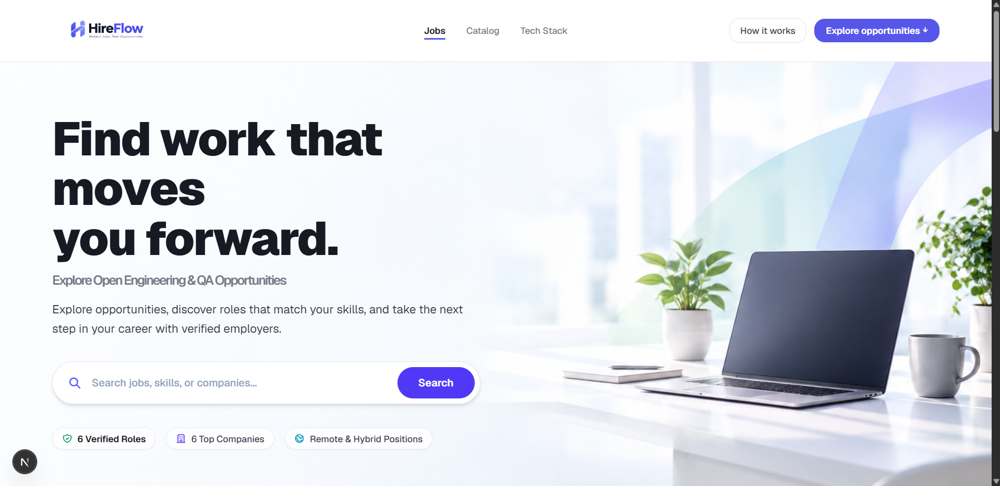
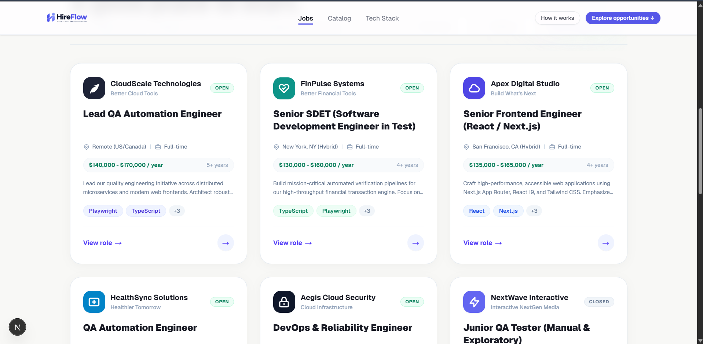
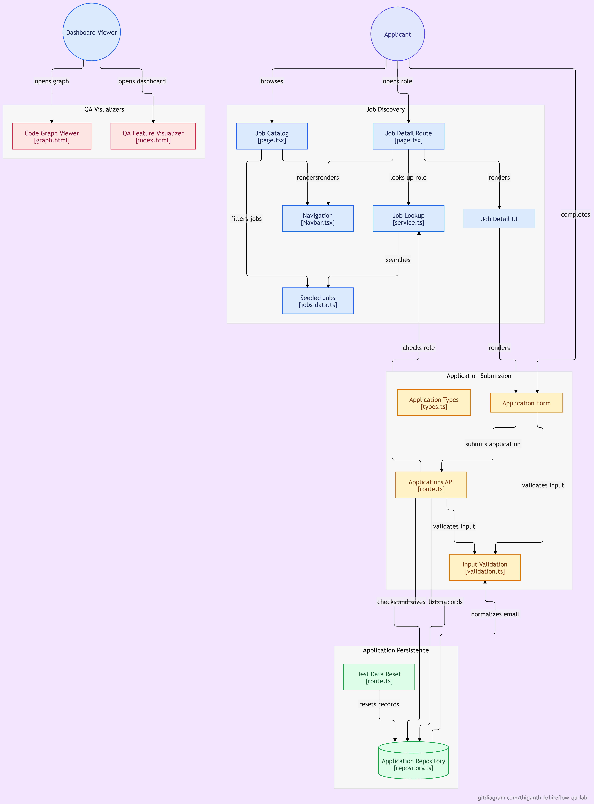

# HireFlow QA Lab

<div align="center">


### High-Reliability Job Application Portal & Quality Assurance Engineering Harness
**Built with Next.js 15 • Graphify AST Code Intelligence • UI/UX Pro Max Design System • Playwright Automated Harness**

[](https://nextjs.org/)
[](https://react.dev/)
[](https://www.typescriptlang.org/)
[-success?logo=playwright)](https://playwright.dev/)
[](https://tailwindcss.com/)
[](./graphify-out/graph.html)
[](./qa-guide/index.html)

[Overview](#1-project-purpose--assessment-context) • [Live Visualizers](#2-interactive-visualizers--dashboards) • [UI/UX Pro Max](#3-uiux-pro-max-design-system) • [Graphify AST](#4-graphify-codebase-intelligence) • [QA Test Harness](#5-qa-engineering-scope--41-automated-scenarios) • [Getting Started](#6-getting-started--execution-guide) • [Potential & Architecture](#7-architecture-potential--production-readiness) • [Notes & Trade-offs](./docs/notes-tradeoffs-limitations.md)

---

</div>

## 1. Project Purpose & Assessment Context

**HireFlow QA Lab** is a high-reliability recruitment web platform created as part of the **HireKiwi (Infinitica) QA Engineer Assessment**. The platform provides an end-to-end job discovery, review, and application submission workflow specifically architected for testability, deterministic verification, accessibility compliance, and controlled failure simulation.



### 🎯 Assessment Scope Alignment

| Testing Scope Area | Assessment Requirement | Implementation & Verification | Automated Scenarios |
|---|---|---|:---:|
| **1. Job Listings** | Verify that job titles, salaries, experience requirements, and descriptions are displayed correctly. | • 6 deterministic seed positions with stable IDs.<br>• Titles, companies, salary ranges, experience, locations, and descriptions rendered with exact test identifiers.<br>• Dynamic keyword search and multi-faceted filtering by type and status.<br>• Minimalist empty state when zero results match. | [`critical-scenarios.spec.ts`](./tests/critical-scenarios.spec.ts) (Scenario 1)<br>[`catalog-filters.spec.ts`](./tests/catalog-filters.spec.ts) (Scenarios 26–32) |
| **2. Dynamic Navigation** | Test that job links open the correct role and that navigation works as expected. | • Job card click and action links navigate to `/jobs/[id]`.<br>• Dynamic server resolution loads matching responsibilities & requirements.<br>• "Back to Catalog" maintains filter and search state.<br>• Invalid IDs gracefully route to an accessible 404 error page. | [`critical-scenarios.spec.ts`](./tests/critical-scenarios.spec.ts) (Scenarios 2 & 5) |
| **3. Form Validation** | Cover missing required fields, invalid email formats, whitespace-only input, and boundary cases. | • **Required fields**: Missing Full Name, Email, Phone, Resume URL trigger immediate inline alerts.<br>• **Whitespace-only**: Inputs consisting solely of `'   '` are rejected.<br>• **Email formats**: RFC-5322 regex checks (missing `@`, invalid domain, double dots).<br>• **Boundary limits**: Name (2–80 chars), Phone (7–25 chars, min 7 digits), Resume URL (protocol `http://` or `https://`), Cover Letter (max 2,000 chars).<br>• **Accessible UX**: Auto-focus jumps to the first invalid field, and errors clear dynamically on keystroke. | [`critical-scenarios.spec.ts`](./tests/critical-scenarios.spec.ts) (Scenario 3)<br>[`extended-scenarios.spec.ts`](./tests/extended-scenarios.spec.ts) (Scenarios 6–7)<br>[`form-boundaries.spec.ts`](./tests/form-boundaries.spec.ts) (Scenarios 21–25) |
| **4. Submission & Resilience** | Verify application submission, network handling, duplicate submission, server error simulation, etc. | • **Happy Path**: Valid submission persists record, returns HTTP 201, and displays success banner with confirmation ID.<br>• **Deduplication**: Submitting the same email for the same job triggers HTTP 409 Conflict.<br>• **Canonical Normalization**: ` CANDIDATE@EXAMPLE.COM ` normalized to `candidate@example.com`.<br>• **Concurrency / Race Conditions**: 5 parallel requests fired with `Promise.all` — compound unique index allows exactly 1 (201) and rejects 4 (409).<br>• **Network & Server Errors**: Simulation headers (`x-test-simulate-delay`, `x-test-simulate-error: 500`) verify loading states, disabled buttons, and user-friendly error recovery.<br>• **PII Protection**: `GET /api/applications` fails-closed with 401 Unauthorized unless authenticated via `ADMIN_API_KEY`. | [`critical-scenarios.spec.ts`](./tests/critical-scenarios.spec.ts) (Scenario 4)<br>[`hardening-scenarios.spec.ts`](./tests/hardening-scenarios.spec.ts) (Scenarios 11–20)<br>[`api-contracts.spec.ts`](./tests/api-contracts.spec.ts) (Scenarios 33–36) |

---

## 2. Interactive Visualizers & Dashboards

This project includes **two standalone interactive visual dashboards** requiring zero installation or compilation:

```
hireflow-qa-lab/
├── qa-guide/index.html          # Interactive QA Guide & Live Feature Visualizer
└── graphify-out/graph.html       # Persistent Codebase AST Knowledge Graph
```

### 1. Interactive QA Features Visualizer (`qa-guide/index.html`)
Open in any browser:
```powershell
start qa-guide/index.html
```
- **Live Sandboxes**:
  - *Boundary Sandbox*: Type names, emails, phones, and URLs to watch RFC regex and boundary limits trigger live hints in real time.
  - *Scenario 15 Concurrency Race Simulator*: Fire 5 simulated concurrent threads at once to watch the atomic compound index permit exactly 1 thread (201 Created) and reject 4 (409 Conflict).
  - *Normalization Sandbox*: Test uppercase, padded emails to see canonical normalization in action.
  - *PII Access Control Simulator*: Toggle between public, invalid, and admin tokens to inspect candidate protection.
- **Traceability Matrix**: Complete 41-scenario matrix filterable by Priority (**P0 Blocker**, **P1 High**, **P2 Medium**).
- **Presentation Toolkit**: Elevator pitch, technical deep dive, and interview flashcards.

### 2. Graphify Codebase Graph Visualizer (`graphify-out/graph.html`)
Open in any browser:
```powershell
start graphify-out/graph.html
```
- Interactive visual graph displaying file relationships, dependencies, module clusters, and symbols across the entire repository.

---

## 3. UI/UX Pro Max Design System

The user interface follows the **Quiet Precision** design methodology, balancing high visual appeal with strict functional symmetry:



### 🎨 Key Design System Highlights

1. **3-Layer Design Token Architecture**:
   - *Primitive Tokens*: Raw HSL / hex color palettes (`#F8F8F6`, `#171923`, `#5657E8`).
   - *Semantic Tokens*: `--canvas`, `--surface`, `--ink`, `--muted`, `--accent`, `--success`, `--border`.
   - *Component Tokens*: Buttons, badges, and cards consuming predefined variables for effortless light/dark adaptability.

2. **Fixed-Height Symmetrical Card Engineering**:
   - Meticulously structured 3-column Opportunity Cards with **locked row heights**:
     - *Company Header*: Locked `h-13` with brand-specific SVG icons and truncated taglines.
     - *Job Title*: Locked `h-14 sm:h-16 flex items-start line-clamp-2` preventing vertical row displacement.
     - *Location & Meta*: Locked `h-6` with map pin and briefcase icons.
     - *Salary & Experience*: Locked `h-8` micro-pill.
     - *Description*: Locked `h-10 line-clamp-2` eliminating variable white space.
     - *Skill Pills*: Single-row locked `h-7 overflow-hidden` rendering primary skills and `+X` count.
     - *Action Footer*: Bottom-anchored `mt-auto pt-4` ensuring **`View role →`** and circle buttons line up on the exact same horizontal baseline across all cards.

3. **Dynamic Expandable Navbar**:
   - Client-side scroll detection (`Navbar.tsx`):
     - *At top*: Spacious header (`h-20 sm:h-24`) with prominent branding.
     - *On scroll*: Smoothly transitions to compact sticky bar (`h-16 sm:h-18`) with glassmorphic backdrop blur (`backdrop-blur-md shadow-sm`).
     - *Dead-center navigation*: Nav links (`Jobs`, `Catalog`, `Tech Stack`) horizontally centered via `absolute left-1/2 -translate-x-1/2`.

4. **Zero-Overhead CSS Micro-Animations**:
   - Custom `@keyframes heroEntrance` and `@keyframes badgeEntrance` in `globals.css`.
   - Staggered delays (`stagger-1`, `stagger-2`, `stagger-3`) for smooth entrance choreography without heavy JavaScript animation dependencies.

5. **Accessibility & Hydration Safety (WCAG AAA)**:
   - High contrast text (`--ink` on `--canvas`).
   - Focus visible outlines (`focus-visible:ring-2 focus-visible:ring-indigo-600`).
   - React 19 `useSyncExternalStore` hydration guarding ensuring automation cannot trigger form submissions before client hydration completes.

---

## 4. Graphify Codebase Intelligence

**Graphify** provides structural intelligence by parsing the repository into an Abstract Syntax Tree (AST) knowledge graph:

### 🧠 Graph Highlights ([`graphify-out/GRAPH_REPORT.md`](./graphify-out/GRAPH_REPORT.md))

- **Total Analyzed Nodes**: 54 source code nodes across App Router routes, components, and services.
- **AST Relationship Extraction**: Complete mapping of imports, types, functional calls, and React component boundaries.
- **God-Node Prevention**: Detects potential monolithic files and enforces clean separation of concerns:
  - `src/lib/applications/repository.ts` — Strictly persistence & deduplication logic.
  - `src/lib/applications/validation.ts` — Pure boundary rules & validation engines.
  - `src/components/ApplicationForm.tsx` — Isolated UI interactions & accessible form state.
  - `src/components/JobDetailInteractive.tsx` — Independent client reveal component.
- **Zero Circular Dependencies**: All modules form a strict unidirectional acyclic dependency hierarchy.

---

## 5. QA Engineering Scope & 41 Automated Scenarios

The automated test suite is built on **Playwright Test** with web-first assertions, deterministic state resets, and zero arbitrary timeouts.

### 🧪 Test Suite Hierarchy (All 41 Passed)

```
tests/
├── critical-scenarios.spec.ts       # 5 Core P0 Scenarios (Catalog, Detail, Validation, Success, 404)
├── catalog-filters.spec.ts          # 7 Scenarios (Title, Company, Location, Skills, Type, Status, Empty)
├── form-boundaries.spec.ts          # 5 Scenarios (Max lengths, RFC emails, dynamic error clearing, focus)
├── extended-scenarios.spec.ts       # 7 Scenarios (Whitespace, boundaries, submit lockout, 500 error)
├── hardening-scenarios.spec.ts      # 13 Scenarios (Concurrency race, normalization, PII, lockout)
└── api-contracts.spec.ts            # 4 Scenarios (HTTP 415, malformed JSON, 404 job check, status codes)
```

### 📊 Test Execution Summary

| Suite File | Executed | Passed | Failed | Duration | Focus Area |
|---|:---:|:---:|:---:|:---:|---|
| `critical-scenarios.spec.ts` | 5 | 5 | 0 | ~6.7s | Core candidate journey & essential metadata |
| `catalog-filters.spec.ts` | 7 | 7 | 0 | ~6.7s | Search filters, keywords & catalog empty states |
| `form-boundaries.spec.ts` | 5 | 5 | 0 | ~4.6s | Boundary limits, RFC-5322 regex & focus control |
| `extended-scenarios.spec.ts` | 7 | 7 | 0 | ~9.9s | Whitespace rejections, submit guards & error recovery |
| `hardening-scenarios.spec.ts` | 13 | 13 | 0 | ~6.2s | Concurrency race condition, deduplication & PII protection |
| `api-contracts.spec.ts` | 4 | 4 | 0 | ~0.4s | Content-Type enforcement & malformed payload rejection |
| **Combined Execution Total** | **41** | **41** | **0** | **37.6s** | **100% Automated Pass Rate** |

### 🛡️ Critical QA Features Deep Dive

1. **TOCTOU Concurrency Race Condition Mitigation (Scenario 15)**:
   - *Problem*: In traditional databases, two parallel requests checking if a candidate exists before writing can both pass the read check and write duplicate applications.
   - *Fix*: MongoDB compound unique index `{ normalizedEmail: 1, jobId: 1 }` backed by in-process `AsyncMutex`. When 5 parallel requests are fired simultaneously with `Promise.all`:
     - **Thread 1**: Successfully creates record (`201 Created`).
     - **Threads 2–5**: Engine throws duplicate key error `11000`, cleanly mapped to structured `409 Conflict`.

2. **Applicant PII Protection & Access Control (Scenario 17 & 18)**:
   - `GET /api/applications` exposes sensitive applicant resumes, emails, and phone numbers.
   - Strictly protected via `ADMIN_API_KEY`. Unauthenticated requests fail-closed with `401 Unauthorized` without leaking any candidate information.

3. **Production Safety Lockdown (Scenario 12 & 19)**:
   - The test-support reset route (`POST /api/test-support/reset`) unconditionally returns `403 Forbidden` whenever `NODE_ENV === 'production'`, preventing accidental database wipes.

4. **Split-Brain Storage Protection**:
   - If `MONGODB_URI` is configured and MongoDB becomes unreachable, the system returns **HTTP 503 Service Unavailable** rather than silently falling back to a local JSON file, preventing bifurcated records.

---

## 6. Getting Started & Execution Guide

### Prerequisites
- **Node.js**: v20+ or v22+ LTS installed
- **npm**: v10+

### 1. Installation
```bash
# Clone the repository
git clone https://github.com/Thiganth-K/hireflow-qa-lab.git
cd hireflow-qa-lab

# Install dependencies
npm install

# Install Playwright browser binaries
npx playwright install chromium
```

### 2. Environment Configuration
Copy `.env.example` to `.env.local`:
```bash
cp .env.example .env.local
```
*(Optionally set `MONGODB_URI` for native MongoDB persistence or leave blank for local atomic file persistence).*

### 3. Run Development Server
```bash
npm run dev
```
Open [http://localhost:3000](http://localhost:3000) in your browser.

### 4. Execute Automated Test Suites
```bash
# Run all 41 Playwright scenarios
npm run test:e2e

# View the interactive HTML test report
npm run test:report

# Run specific suites
npx playwright test tests/critical-scenarios.spec.ts
npx playwright test tests/hardening-scenarios.spec.ts
```

### 5. Static Code Quality Audits
```bash
# Verify TypeScript strict type compliance
npx tsc --noEmit

# Run ESLint rules
npm run lint

# Build optimized production bundle
npm run build
```

---

## 7. Architecture, Potential & Production Readiness



### 🏛️ Component Architecture Map

```
hireflow-qa-lab/
├── src/
│   ├── app/
│   │   ├── api/
│   │   │   ├── applications/route.ts       # POST application submission & GET PII retrieval
│   │   │   └── test-support/reset/         # POST test isolation reset endpoint (dev-only)
│   │   ├── jobs/
│   │   │   ├── [id]/page.tsx               # Dynamic job details with Suspense App Shell
│   │   │   └── page.tsx                    # Route alias to catalog
│   │   ├── globals.css                     # Design tokens & keyframe in-animations
│   │   ├── layout.tsx                      # Root layout & Geist typography
│   │   └── page.tsx                        # Hero, Symmetrical Catalog & Dev Stack sections
│   ├── components/
│   │   ├── ApplicationForm.tsx             # Accessible, hydrated candidate submission form
│   │   ├── JobDetailInteractive.tsx        # Client interactive card reveal container
│   │   └── Navbar.tsx                      # Scroll-reactive dynamic navigation bar
│   └── lib/
│       ├── applications/
│       │   ├── repository.ts               # Concurrency mutex & persistence backend
│       │   ├── types.ts                    # Application models & error interfaces
│       │   └── validation.ts               # Boundary gates & RFC-5322 validation
│       └── jobs/
│           ├── jobs-data.ts                # Deterministic seed job catalog
│           ├── service.ts                  # Query & filtering service
│           └── types.ts                    # Job definitions & contract interfaces
```

### 🚀 Production Potential

1. **Enterprise Scalability**:
   - The persistence layer is completely decoupled. With `MONGODB_URI` connected, HireFlow handles thousands of concurrent applications with atomic compound uniqueness.
2. **Microservices Ready**:
   - Route handlers follow standard REST conventions (`201`, `400`, `404`, `409`, `415`, `500`, `503`) and can easily plug into external applicant tracking systems (ATS), webhook dispatchers, or email notification queues.
3. **Continuous Integration & Delivery (CI/CD)**:
   - With isolated reset hooks and zero-flakiness web-first locators, all 41 Playwright tests run in under 40 seconds on GitHub Actions or GitLab CI runners.
4. **Developer Ergonomics**:
   - Graphify AST extraction keeps the codebase transparent, and the UI/UX Pro Max design system ensures that any new components adhere to established visual standards.

---

## 8. Assessment Submission Checklist

- [x] **Job Listings Display**: Title, company, salary, experience, location, and description verified.
- [x] **Dynamic Navigation**: Job links open matching roles; breadcrumb & 404 error routing verified.
- [x] **Form Validation**: Missing required fields, RFC email regex, whitespace `'   '` rejection, and boundary limits verified.
- [x] **Application Submission**: Happy path, duplicate prevention, canonical normalization, concurrency race conditions, and controlled error simulations verified.
- [x] **Security & Access Control**: Candidate PII protected behind `ADMIN_API_KEY`; production lockout enforced.
- [x] **Test Documentation**: Comprehensive test plan ([`docs/test-plan.md`](./docs/test-plan.md)), 41 test cases ([`docs/test-cases.md`](./docs/test-cases.md)), and defect audit reports ([`docs/bug-reports.md`](./docs/bug-reports.md)).
- [x] **Notes, Trade-offs & Limitations**: Architectural notes, conscious engineering trade-offs, and production roadmap ([`docs/notes-tradeoffs-limitations.md`](./docs/notes-tradeoffs-limitations.md)).
- [x] **Interactive Dashboards**: Standalone Visual QA Guide ([`qa-guide/index.html`](./qa-guide/index.html)) and Graphify AST Graph ([`graphify-out/graph.html`](./graphify-out/graph.html)).
- [x] **Automated Execution**: 41/41 Playwright scenarios passing (100% pass rate).
- [x] **Code Quality**: TypeScript (`npx tsc --noEmit`) and ESLint (`npm run lint`) passing with **0 errors**.

---

<div align="center">

**Developed by Thiganth K • Built for HireKiwi (Infinitica) QA Assessment**  
*Deterministic Testing • Graphify AST Intelligence • UI/UX Pro Max System*

</div>
